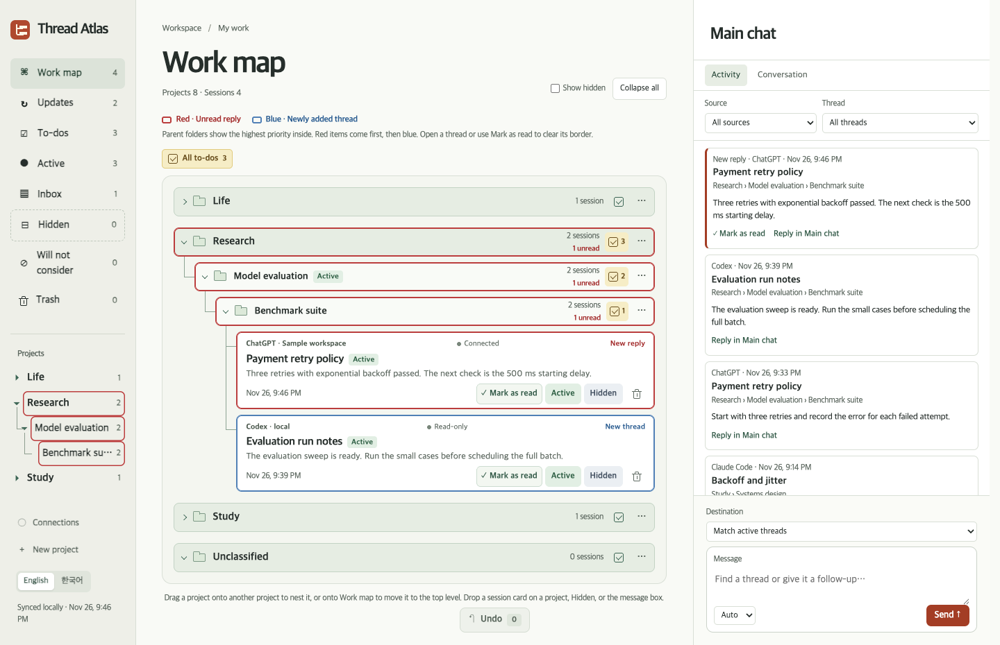
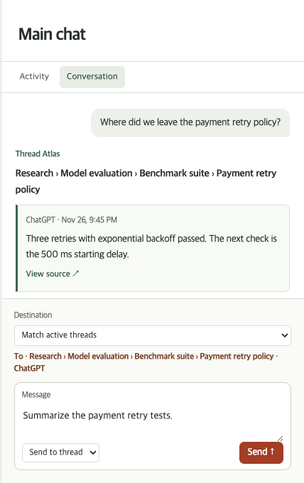
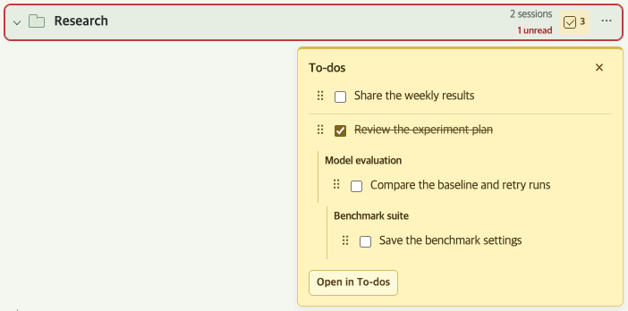

# Thread Atlas

Thread Atlas is a local workspace for conversations from Codex, Claude Code, ChatGPT, and Claude. Organize threads into project folders, catch up on replies, and continue a conversation from the dashboard. The interface supports English and Korean.



*The screenshots use sample threads and to-dos.*

## Get started

On macOS, double-click **Start.command** in the checkout or run it from a terminal. The launcher starts the local server and opens the dashboard. It uses the locked dependencies when uv is installed. The fallback installer requires Python 3.9 or later.

```sh
./Start.command
```

On Linux, run the following from the checkout.

```sh
uv sync --frozen
uv run python -m atlas
```

Add `--no-open` to start the collector without opening a browser. Rerun the launcher to reopen the dashboard.

The [v0.1.0 release](https://github.com/ainta/thread-atlas/releases/tag/v0.1.0) includes an ad-hoc-signed Apple Silicon menu-bar app. To build the current checkout as a macOS app, install the Xcode command line tools and run the following. The menu can reopen the dashboard or reveal the extension folder. The collector keeps running when you close the browser tab.

```sh
./macos/build.sh
open "build/Thread Atlas.app"
```

## Connect your conversations

| Source | Read | Reply |
| --- | --- | --- |
| Codex | Reads local transcripts. **Connections → Import Codex history** also indexes threads from the signed-in local App Server. | Sends to the original thread through the App Server when the thread is available. |
| Claude Code | Reads local project transcripts. | Resumes the session in its original working directory. A session open in another terminal is protected from concurrent writes. |
| ChatGPT and Claude | Import an export or track selected open Chrome tabs. | Sends through a connected tab with **Allow replies to this thread** enabled. |

Keep the local Codex App Server daemon running. On versions with daemon management, use `codex app-server daemon start` if it is stopped. Claude Code replies require a signed-in CLI with `claude agents --json` support.

**Import a snapshot.** In **Connections**, choose a provider and account label, then select a JSON or ZIP export. Reuse the same label on later imports so Thread Atlas can match existing conversations. With a new ChatGPT export ZIP in Downloads, click **Refresh ChatGPT** to import additions and see the count of new chats and messages.

**Track a live tab.** In Chrome, open `chrome://extensions`, enable Developer mode, and use **Load unpacked** on this checkout's `extension` directory. Reload the source tab once after installation. Copy the pairing key from **Connections**, paste it into the extension, and enter the same account label you use for imports. Click **Track open chats**. Enable **Allow replies to this thread** on each tab where you want to send messages. A navigation or disconnect can require reconnecting the tab.

## Set up the Work map

The first-run setup offers **Research**, **Life**, and **Study**. You can edit the starter folders, add subfolders, or skip setup. **Unclassified** collects threads without a clear match. New ChatGPT threads can be filed into an existing folder when their topic matches.

For example, you might keep a benchmark thread three levels deep.

```text
Research
└── Model evaluation
    └── Benchmark suite
        └── Payment retry policy
```

Drag a thread onto a folder to move it. Drag a folder onto another folder to move the entire branch, or drop it on **Work map** in the sidebar to move it to the top level. A folder's **⋯** menu also lets you add a subproject or move the folder up or down among its siblings.

| Status | Where it appears |
| --- | --- |
| **Default** | Work map |
| **Active** | Work map, Active, and automatic matching in Main chat |
| **Hidden** | Hidden, or its original folder when **Show hidden** is on |
| **Will not consider** | Its own sidebar view, with a **Restore** action |

Set a thread's status from its card or details. Use the folder's **⋯** menu to set status for a branch. Visible threads in an active folder are eligible for automatic matching. Until you mark any thread or folder Active, every visible thread is eligible.

Open a thread and click **Rename** to give it a workspace title that survives sync. **Use original title** switches back to the source title. The trash-can button moves a thread to **Trash**, where you can restore it. **Undo** reverses the last 10 workspace edits one at a time, including renames, folder moves, and status changes.

## Catch up and reply

1. Open **Updates** to see only threads that need a look. Red marks an unread reply, and blue marks a newly added thread. Parent folders inherit the highest-priority marker. Inside a folder, red items come first, then blue.
2. Click a thread to see its history, or click **✓ Mark as read** to clear its marker from the card. The checkmark also appears on unread replies in **Inbox** and **Main chat → Activity**.
3. Click **Reply here** to send from the thread window. **Open original** follows a linked web conversation or opens a local Codex thread in the desktop app. For a read-only thread, use **Copy draft**.

In the right panel, use **Activity** to filter replies by source or thread. Choose a **Destination** to follow up without opening the thread. **Conversation** shows what you sent and any replies that came back.

| In Main chat | Example |
| --- | --- |
| **Find** with **Match active threads** | “Where did we leave the payment retry policy?” |
| **Send to thread** with **Match active threads** | “Summarize the payment retry tests.” |
| **Send to thread** with a specific **Destination** | Select **Payment retry policy** and type “Try a backoff of 500 ms.” |

**Auto** chooses between finding and sending. Thread Atlas matches titles, project names, recent replies, and every stored message, then previews the destination. It asks you to choose when the match is unclear, and asks before sending to a thread that only an older message matched. When **Find** matched an older message, the answer shows it with its time, and **View source** opens the history at that message. A specific destination can be any visible thread.



## Keep project to-dos

Click the yellow checklist icon next to a folder to open its memo. For example, the **Research** memo shows its own checklist and the tasks under **Model evaluation → Benchmark suite**, indented by folder. **All to-dos** opens a memo for the entire Work map.



Check tasks off in the memo, or click **Open in To-dos** to add and organize them in the full view. Drag a task's **⠿** handle above or below another task to reorder it, or drop it on a different folder to move it. Click the handle for a project and position picker. **Undo** also works for to-do changes.

## Notifications and local data

Turn on **Local notifications** in **Connections** and allow **Thread Atlas Alerts** when macOS asks. Clicking a banner opens the exact reply. Optional Telegram notifications use `ATLAS_TELEGRAM_TOKEN` and `ATLAS_TELEGRAM_CHAT` and send the thread title. Delivery receipts show whether a follow-up was queued, sent, answered, failed, or could not be confirmed.

The dashboard binds to `127.0.0.1:43821`. On macOS, the SQLite database, launch URL, and pairing credential are stored in `~/Library/Application Support/Thread Atlas`. On Linux, the default is `~/.local/share/Thread Atlas`, or `$XDG_DATA_HOME/Thread Atlas` when set. The database holds thread history, project layout, read markers, titles, and to-dos. The dashboard browser profile holds drafts, language, the reply target, and Main chat history. Use `--port`, `--data`, `--codex-dir`, or `--claude-dir` to override defaults.

The Chrome extension reads visible conversation content in the tabs you connect. It talks to the loopback server with the pairing key. It protects an existing draft in the source composer and waits for evidence of delivery.

## Verification

```sh
uv sync --frozen
uv run python -m unittest discover -s test -v
node test/router.mjs
uv pip install playwright
uv run playwright install chromium
uv run python scripts/browser_test.py
```

The browser suite runs in an isolated Chromium profile with fixture pages for the web providers. The opt-in live suite uses authenticated providers, creates four disposable conversations, and consumes model usage.

```sh
uv run python scripts/live_test.py --live
```

[English design](docs/DESIGN.md) · [한국어 설계](docs/DESIGN.ko.md) · [Verification notes](docs/VERIFICATION.md) · [Original-thread receipts](docs/live-receipts.json)
